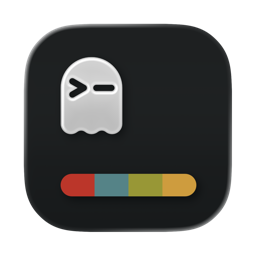
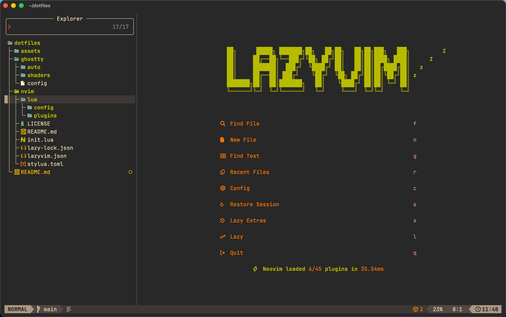
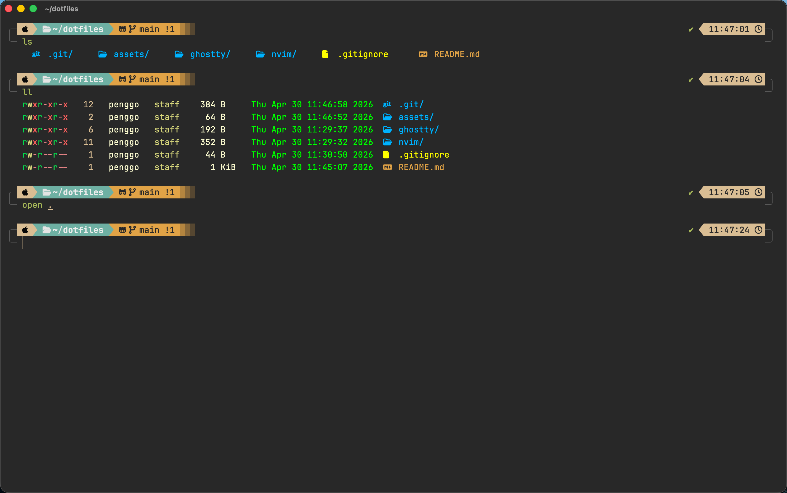

#  Penggo's Dotfiles

<p align="center">
  
</p>

<p align="center">
  
  
  
  
  
</p>

<p align="center">
  <a href="README.md">English</a> · <a href="README.zh-CN.md">简体中文</a> · <a href="README.ja.md">日本語</a>
</p>

macOS 向けの個人開発環境設定です。高速・シンプル・効率的をテーマにしています。現在は **Neovim** と **Ghostty** の設定を含んでいます。

## 📸 スクリーンショット

| Neovim | Ghostty |
| :---: | :---: |
|  |  |

## 🛠 同梱ツールと設定

- **[Neovim](https://neovim.io/):** Lua で書かれた高度にカスタマイズされたターミナルエディタ設定。IDE のような体験を提供します。
- **[Ghostty](https://ghostty.org/):** GPU アクセラレーション対応のモダンなターミナルエミュレータの設定。カスタムテーマとシェーダーを含みます。

## ✨ 主な特徴

- 🚀 **超高速起動**: 最適化された LazyVim 構成により、エディタが一瞬で開きます。
- 💎 **モダンな美学**: 丁寧に調整された UI 要素、スムーススクロールとカーソルエフェクトに対応。
- ⌨️ **効率的なナビゲーション**: Blink.cmp ベースの補完エンジン。高速かつ正確です。
- 🌈 **シンタックス強化**: Treesitter 完全対応で、あらゆる言語を美しくハイライト。
- 🖥️ **GPU レンダリング**: Ghostty のハードウェアアクセラレーションとカスタムシェーダーを活用。
- 🛠️ **ワンステップ導入**: インストールと管理が簡単なシンボリックリンク構成。

## ⚙️ 技術スタック

### [Neovim](https://neovim.io/) (v0.10+)
- **フレームワーク**: [LazyVim](https://www.lazyvim.org/)
- **補完エンジン**: [Blink.cmp](https://github.com/Saghen/blink.cmp) — 次世代の超高速補完。
- **ファイルツリー**: [Neo-tree](https://github.com/nvim-neo-tree/neo-tree.nvim)
- **UI コンポーネント**: [Bufferline](https://github.com/akinsho/bufferline.nvim)、[Lualine](https://github.com/nvim-lualine/lualine.nvim)
- **エフェクト**: `smooth-effects` によるスムーススクロール。

### [Ghostty](https://ghostty.org/)
- **ターミナルエミュレータ**: GPU アクセラレーションによる優れたパフォーマンス。
- **ビジュアル強化**: `in-game-crt-cursor.glsl` カスタムシェーダーを同梱し、独自の視覚フィードバックを提供。

## 📂 ディレクトリ構成

```text
.
├── nvim/      # Neovim 設定 (~/.config/nvim)
├── vim/       # 基本の Vim 設定 (~/.vimrc)
├── ghostty/   # Ghostty ターミナル設定 (~/Library/Application Support/com.mitchellh.ghostty)
├── assets/    # アイコンとスクリーンショット
└── README.md
```

## ⚡️ インストール

> [!WARNING]
> **警告：** 以下の手順は既存の設定を上書きします。実行前に必ずバックアップを取ってください！

リポジトリを `git clone` し、シンボリックリンクで設定ファイルを配置します。

### 1. クローン

```bash
git clone https://github.com/penggo/dotfiles.git ~/dotfiles
cd ~/dotfiles
```

### 2. シンボリックリンクの作成

以下のネイティブコマンドで手動でリンクできます：

#### 🔗 Neovim & Vim をリンク

```bash
# 古い設定をバックアップ（存在する場合）
mv ~/.config/nvim ~/.config/nvim.bak 2>/dev/null || true
mv ~/.vimrc ~/.vimrc.bak 2>/dev/null || true

# シンボリックリンクを作成
ln -s ~/dotfiles/nvim ~/.config/nvim
ln -s ~/dotfiles/vim/vimrc ~/.vimrc
```

#### 🔗 Ghostty をリンク (macOS)

```bash
# 古い設定をバックアップしてクリーンアップ
GHOSTTY_DIR="$HOME/Library/Application Support/com.mitchellh.ghostty"
mv "$GHOSTTY_DIR" "${GHOSTTY_DIR}.bak" 2>/dev/null || true

# シンボリックリンクを作成
ln -s ~/dotfiles/ghostty "$GHOSTTY_DIR"

# ~/.config 側にもリンクしておくことを推奨
mkdir -p ~/.config/ghostty
ln -s ~/dotfiles/ghostty/config ~/.config/ghostty/config
```

## 🤝 コントリビューションとフィードバック

これは私個人の設定で、高度にカスタマイズされており、私自身の習慣に紐づいています。とはいえ、バグを見つけたり改善のアイデアがあれば、Issue や Pull Request を歓迎します！

この設定が役に立ったら、**Star** 🌟 をもらえると嬉しいです！

## 📄 License

[MIT License](LICENSE)
